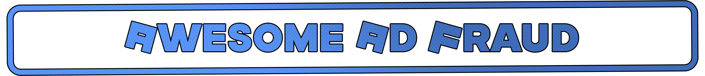

 <!-- -SVG-Line- -->

A curated collection of open-source tools, verification platforms, supply chain utilities, datasets, technical standards, and primary research for detecting, measuring, and eliminating ad fraud and invalid traffic (IVT) across the digital advertising ecosystem.

## Contents

  - [Ad Fraud & IVT Detection Platforms](#ad-fraud--ivt-detection-platforms)
      - [Open-Source IVT & Click Fraud Tools](#open-source-ivt--click-fraud-tools)
      - [Enterprise Ad Verification & IVT Platforms](#enterprise-ad-verification--ivt-platforms)
      - [PPC & Performance Click-Fraud Protection](#ppc--performance-click-fraud-protection)
  - [Supply Chain Transparency (ads.txt, app-ads.txt, sellers.json)](#supply-chain-transparency-adstxt-app-adstxt-sellersjson)
      - [Reference Implementations & Specifications](#reference-implementations--specifications)
      - [Open-Source Parsers, Crawlers & Libraries](#open-source-parsers-crawlers--libraries)
      - [Web Validators & Publisher Management](#web-validators--publisher-management)
  - [Bot Detection, Fingerprinting & Network Intelligence](#bot-detection-fingerprinting--network-intelligence)
      - [Client-Side Detection & Browser Fingerprinting](#client-side-detection--browser-fingerprinting)
      - [User-Agent & Device Classification](#user-agent--device-classification)
      - [Network, TLS & Edge Bot Mitigation](#network-tls--edge-bot-mitigation)
      - [Evasion Research & Red-Teaming](#evasion-research--red-teaming)
  - [Malvertising, Creative Security & Mobile Attribution Fraud](#malvertising-creative-security--mobile-attribution-fraud)
      - [Malvertising & Ad Security](#malvertising--ad-security)
      - [Mobile Attribution & App Fraud Prevention](#mobile-attribution--app-fraud-prevention)
  - [MFA (Made for Advertising) & Supply Path Quality](#mfa-made-for-advertising--supply-path-quality)
  - [Standards, Protocols & Industry Bodies](#standards-protocols--industry-bodies)
      - [Supply Chain & Auction Standards](#supply-chain--auction-standards)
      - [Measurement, Creative Sandboxing & Accreditation](#measurement-creative-sandboxing--accreditation)
  - [Datasets, Benchmarks & Academic Research](#datasets-benchmarks--academic-research)
      - [Datasets & Open Intelligence Feeds](#datasets--open-intelligence-feeds)
      - [Landmark Papers, Studies & Enforcement](#landmark-papers-studies--enforcement)
  - [Browser Extensions & Inspection Tools](#browser-extensions--inspection-tools)
      - [Network & Waterfall Inspection](#network--waterfall-inspection)
      - [Browser Extensions](#browser-extensions)
      - [Site & Ad-Tech Scanners](#site--ad-tech-scanners)
  - [Books, Talks & Blogs](#books-talks--blogs)
      - [Books & Talks](#books--talks)
      - [Blogs, Engineering Notes & Newsrooms](#blogs-engineering-notes--newsrooms)
  - [Contributing](#contributing)
  - [License](#license)

 <!-- -SVG-Line- -->

## Ad Fraud & IVT Detection Platforms

*Open-source engines, enterprise verification suites, and click-fraud blockers for filtering automated traffic and invalid impressions or clicks.*

### Open-Source IVT & Click Fraud Tools

 [AdGuardSentinel](https://github.com/DuffyEthan/AdGuardSentinel) - Real-time publisher campaign anomaly detection using Isolation Forest models on TimescaleDB with a FastAPI and React dashboard.

 [AdTruth](https://github.com/papa-torb/adtruth) - Lightweight open-source JavaScript and ML tool that scores click fraud and bot traffic across Google, Meta, and TikTok ad campaigns.

 [clickcutter](https://github.com/Xelessar/clickcutter) - Rule-based Google Ads click-fraud pipeline combining a GTM tracking beacon, Airflow scoring, and automated IP exclusions via the Google Ads API.

 [Nameles](https://github.com/Nameles-Org/Nameles) - Open-source entropy-based invalid traffic detection and real-time pre-bid filtering engine designed for DSPs and ad exchanges.

 [PVUV.ai](https://github.com/qiayue/pvuv.ai) - Privacy-friendly, self-hosted web analytics built on Cloudflare Workers and D1 with invalid-traffic detection and AdSense protection.

 [SiteMind](https://github.com/SiteMindOpen/SiteMind) - Open-source counter-ad-fraud project built to analyze media investment traffic quality and filter suspicious ad interactions.

### Enterprise Ad Verification & IVT Platforms

 [Anura](https://www.anura.io) - TAG-certified ad fraud detection platform identifying bots, malware, click farms, and human fraud across web and lead-generation funnels.

 [CHEQ](https://cheq.ai) - Customer acquisition security and go-to-market defense platform blocking bots, fake users, and invalid traffic across paid channels.

 [DoubleVerify](https://doubleverify.com) - MRC-accredited digital media verification suite providing pre-bid avoidance and post-bid measurement for IVT, viewability, and brand suitability.

 [Fraudlogix](https://www.fraudlogix.com) - IP reputation blocklists and post-bid IVT analytics built for DSPs, SSPs, ad exchanges, and affiliate networks.

 [HUMAN Security](https://www.humansecurity.com) - MRC-accredited bot and fraud defense platform known for uncovering Methbot, 3ve, and BADBOX across programmatic web and CTV.

 [Integral Ad Science (IAS)](https://integralads.com) - MRC-accredited verification vendor measuring GIVT, SIVT, viewability, ad clutter, and MFA exposure across web, mobile, and CTV.

 [Pixalate](https://www.pixalate.com) - MRC-accredited fraud intelligence and compliance platform specializing in programmatic, mobile in-app, and CTV invalid traffic measurement.

 [Protected Media](https://www.protected.media) - MRC-accredited and TAG-certified ad verification platform detecting SIVT across display, video, mobile app, and CTV inventory.

### PPC & Performance Click-Fraud Protection

 [24metrics](https://www.24metrics.com) - Real-time click and conversion fraud screening for affiliate networks, lead generation, and performance campaigns.

 [ClickCease](https://www.clickcease.com) - Automated click-fraud monitoring and IP exclusion tool for Google Ads, Microsoft Ads, and Meta campaigns.

 [ClickGUARD](https://www.clickguard.com) - Rule-based and ML click-fraud protection platform automating IP and audience exclusions for PPC campaigns.

 [Lunio](https://www.lunio.ai) - Paid media traffic verification platform blocking bots and junk clicks across Google, Meta, Microsoft, and Performance Max campaigns.

 [Spider AF](https://spideraf.com) - Automated ad fraud, fake lead, and affiliate fraud protection suite screening clicks, conversions, and placements.

 [TrafficGuard](https://www.trafficguard.ai) - Multi-layer IVT and click-fraud prevention platform covering PPC campaigns, affiliate networks, and mobile user acquisition.

 <!-- -SVG-Line- -->

## Supply Chain Transparency (ads.txt, app-ads.txt, sellers.json)

*Parsers, crawlers, validators, and publisher utilities for verifying authorized digital sellers and programmatic supply paths.*

### Reference Implementations & Specifications

 [IAB Tech Lab ads.txt Crawler](https://github.com/InteractiveAdvertisingBureau/adstxtcrawler) - Official Python reference crawler that discovers publishers' ads.txt files and stores parsed records in SQLite.

 [IAB Tech Lab ads.txt Parser](https://github.com/InteractiveAdvertisingBureau/ads.txt-parser) - Official reference parser handling ads.txt syntax and app-ads.txt app-store metadata canonicalization.

 [Supply-Chain-Validation](https://github.com/InteractiveAdvertisingBureau/Supply-Chain-Validation) - Canonical Markdown specification repository for IAB Tech Lab's ads.txt, app-ads.txt, and sellers.json standards.

### Open-Source Parsers, Crawlers & Libraries

 [ads.txt (TypeScript)](https://github.com/perry-mitchell/ads.txt) - TypeScript ads.txt parser and generator published on npm for validating and building seller declarations.

 [adstxt-validator](https://www.npmjs.com/package/adstxt-validator) - TypeScript npm library for validating ads.txt, app-ads.txt, and sellers.json files against IAB specifications.

 [adstxtparser (PHP)](https://github.com/shakaran/adstxtparser) - Open-source PHP library implementing ads.txt file parsing and validation per the OpenRTB working group spec.

 [AppGoblin adscrawler](https://github.com/appgoblin-dev/adscrawler) - Open-source crawler discovering app-ads.txt files, developer domains, and ad SDK footprints across Google Play and the Apple App Store.

 [go-adstxt](https://github.com/suzuken/go-adstxt) - Minimal, dependency-light ads.txt parser written in Go.

 [go-adstxt-crawler](https://github.com/tzafrirben/go-adstxt-crawler) - Golang ads.txt crawler and parser implementing IAB Tech Lab retrieval and parsing rules.

 [sellers.json (TypeScript)](https://github.com/perry-mitchell/sellers.json) - TypeScript sellers.json generator and parser published on npm for inspecting SSP and exchange seller registries.

### Web Validators & Publisher Management

 [Ads.txt Manager (10up)](https://github.com/10up/ads-txt) - WordPress plugin for creating, validating, and maintaining ads.txt and app-ads.txt files from the admin dashboard.

 [ads.txt Guru](https://adstxt.guru/validator/) - Free web validator and API checking ads.txt, app-ads.txt, and sellers.json files for syntax errors, duplicates, and domain issues.

 [Sellers.guide](https://sellers.guide) - Automated supply-chain auditing tool cross-referencing ads.txt declarations against sellers.json entries to flag unauthorized seats.

 <!-- -SVG-Line- -->

## Bot Detection, Fingerprinting & Network Intelligence

*Open-source libraries, edge defenses, IP reputation feeds, and stealth benchmarks for distinguishing automated browsers and botnets from human users.*

### Client-Side Detection & Browser Fingerprinting

 [bot-signal](https://github.com/okasi/bot-signal) - TypeScript bot detector identifying WebDriver, headless Chrome, Playwright/Puppeteer, robotic input, datacenter IPs, and JA3 TLS mismatches.

 [BotD](https://github.com/fingerprintjs/BotD) - Open-source client-side JavaScript library from FingerprintJS that detects automation frameworks and headless browsers directly in the browser.

 [ClientJS](https://github.com/jackspirou/clientjs) - Pure JavaScript library extracting device, browser, canvas, and system properties for client-side fingerprinting.

 [CreepJS](https://github.com/abrahamjuliot/creepjs) - Open research project mapping browser fingerprinting entropy signals, spoofed attributes, and stealth browser evasions.

 [detect-headless](https://github.com/infosimples/detect-headless) - Open-source suite of browser tests demonstrating signals that distinguish headless Chrome from standard user browsers.

 [FingerprintJS](https://github.com/fingerprintjs/fingerprintjs) - Open-source browser fingerprinting library generating visitor identifiers and surfacing environment inconsistencies.

 [FPScanner](https://github.com/antoinevastel/fpscanner) - Self-hosted browser fingerprinting and bot detection library built for analyzing real-world automation anomalies.

 [ThumbmarkJS](https://github.com/thumbmarkjs/thumbmarkjs) - Lightweight, dependency-free open-source JavaScript browser fingerprinting library.

### User-Agent & Device Classification

 [Bowser](https://github.com/bowser-js/bowser) - Compact, maintained JavaScript library for parsing browser, rendering engine, OS, and platform types from user-agent strings.

 [Crawler-Detect](https://github.com/JayBizzle/Crawler-Detect) - Widely used PHP class for detecting bots, crawlers, and spiders via HTTP user-agent headers.

 [crawler_detect (Ruby)](https://github.com/loadkpi/crawler_detect) - Ruby gem for identifying web crawlers, scrapers, and automated bots from user-agent strings.

 [isbot (Go)](https://github.com/arp242/isbot) - Lightweight Go package for classifying HTTP bot and crawler user agents.

 [isbot (JavaScript)](https://github.com/omrilotan/isbot) - JavaScript module detecting bots, crawlers, and spiders from HTTP user-agent patterns.

 [Matomo Device Detector](https://github.com/matomo-org/device-detector) - Universal device, OS, browser, and bot detection engine backed by a community-maintained YAML pattern database.

 [uap-core](https://github.com/ua-parser/uap-core) - Canonical YAML regex database powering ua-parser implementations across Python, Java, Go, Ruby, and JavaScript.

 [uap-python](https://github.com/ua-parser/uap-python) - Python port of ua-parser built directly on the canonical uap-core database.

 [UAParser.js](https://github.com/faisalman/ua-parser-js) - JavaScript user-agent parser extracting browser, engine, OS, device, and CPU metadata.

### Network, TLS & Edge Bot Mitigation

 [Anubis](https://github.com/TecharoHQ/anubis) - Proof-of-work HTTP defense middleware that challenges suspicious requests to block automated scrapers and crawlers.

 [Cloudflare Bot Management](https://www.cloudflare.com/application-services/products/bot-management/) - Edge-layer bot detection combining behavioral ML, TLS heuristics, and Turnstile challenges across global PoPs.

 [Cloudflare Turnstile](https://www.cloudflare.com/application-services/products/turnstile/) - Non-interactive, privacy-preserving browser challenge widget replacing traditional visual CAPTCHAs for visitor verification.

 [CrowdSec](https://github.com/crowdsecurity/crowdsec) - Open-source behavior-based intrusion and bot detection engine sharing crowdsourced malicious IP reputation signals.

 [datacenter-ip-ranges](https://github.com/moonetix/datacenter-ip-ranges) - Daily-updated feeds of cloud, CDN, Tor, iCloud Private Relay, and verified crawler IP ranges with helper libraries.

 [DataDome](https://datadome.co) - Real-time bot, scraper, and AI-agent trust management platform with dedicated click-fraud protection.

 [FireHOL IP Lists](https://github.com/firehol/blocklist-ipsets) - Aggregated, continuously updated IP blocklists covering known botnets, proxies, and abusive networks.

 [human-verified-ai-agent](https://github.com/HumanSecurity/human-verified-ai-agent) - Open-source reference implementation by HUMAN Security using HTTP Message Signatures to authenticate verified AI agents.

 [IPsum](https://github.com/stamparm/ipsum) - Daily threat intelligence feed aggregating malicious and suspicious IP addresses scored by blacklist consensus.

 [is-vpn](https://github.com/josephrocca/is-vpn) - Open-source utility checking whether an IP address belongs to a VPN or datacenter range using daily public feeds.

 [JA4+](https://github.com/FoxIO-LLC/ja4) - Open network fingerprinting standard suite covering TLS, HTTP, QUIC, and TCP signals for identifying automated clients.

 [Nginx Bad Bot Detection](https://github.com/fabriziosalmi/patterns) - Automated bad-bot and OWASP CRS rule patterns for Nginx, Apache, Traefik, and HAProxy reverse proxies.

### Evasion Research & Red-Teaming

 [24metrics Click-Fraud-Bot](https://github.com/24metrics/Click-Fraud-Bot) - Educational Python click-bot using residential proxies to demonstrate how click-fraud operators evade naive IP filters.

 [browser-fingerprinting (Countermeasures)](https://github.com/niespodd/browser-fingerprinting) - Technical analysis of commercial bot-protection systems and browser fingerprinting techniques used in evasion research.

 [browsers-benchmark](https://github.com/techinz/browsers-benchmark) - Benchmark harness evaluating stealth browser engines against Cloudflare, DataDome, Akamai, and PerimeterX bot checks.

 [CloakBrowser](https://github.com/CloakHQ/CloakBrowser) - Source-patched stealth Chromium build designed for testing how fingerprint-hardened browsers evade detection checks.

 [fingerprint-suite](https://github.com/apify/fingerprint-suite) - Open-source fingerprint generation and spoofing toolkit from Apify useful for red-teaming bot detection pipelines.

 [httpcloak](https://github.com/sardanioss/httpcloak) - Go HTTP client replicating browser TLS/HTTP2 fingerprints (JA3/JA4) for testing transport-layer bot defenses.

 [puppeteer-botcheck](https://github.com/prescience-data/puppeteer-botcheck) - Diagnostic test suite verifying which browser automation leaks are visible to client-side bot detectors.

 [puppeteer-extra](https://github.com/berstend/puppeteer-extra) - Modular Puppeteer plugin framework shipping stealth evasions that bot-detection teams must continuously catch.

 [rebrowser-patches](https://github.com/rebrowser/rebrowser-patches) - Patches for Playwright and Puppeteer eliminating CDP and runtime leaks, illustrating modern headless evasion vectors.

 [SeleniumBase](https://github.com/seleniumbase/SeleniumBase) - Python browser automation framework with stealth CDP mode used to benchmark anti-bot resilience.

 [undetected-chromedriver](https://github.com/ultrafunkamsterdam/undetected-chromedriver) - Modified ChromeDriver binary patching automation indicators for red-teaming browser-based fraud defenses.

 <!-- -SVG-Line- -->

## Malvertising, Creative Security & Mobile Attribution Fraud

*Tools and platforms protecting publishers and mobile advertisers from malicious ad payloads, forced redirects, SDK spoofing, and click injection.*

### Malvertising & Ad Security

 [Boltive](https://boltive.com) - Real-time ad security and privacy compliance platform (Ad Lightning) blocking malvertising and redirect attacks for publishers.

 [ClickFix_shield](https://github.com/JosiahGolden/ClickFix_shield) - Lightweight Windows clipboard monitor built in Rust that blocks suspicious PowerShell or CMD payloads from ClickFix malvertising.

 [Confiant](https://www.confiant.com) - Real-time malvertising prevention and creative quality infrastructure monitoring client-side impressions and server-side auctions.

 [GeoEdge](https://www.geoedge.com) - Omnichannel ad security and creative verification platform blocking auto-redirects, phishing, and cloaked malware across web, app, and CTV.

 [obfuscation-detector](https://github.com/HumanSecurity/obfuscation-detector) - AST-based analyzer by HUMAN Security identifying obfuscated JavaScript patterns common in malvertising and evasion payloads.

 [restringer](https://github.com/HumanSecurity/restringer) - Open-source JavaScript deobfuscator from HUMAN Security for unpacking malicious ad scripts and cloaking payloads.

 [SEADS](https://github.com/andpalmier/seads) - Open-source search engine ads scanner built to detect malvertising and brand-impersonation campaigns in search results.

 [SpamdexingSites](https://github.com/elliotwutingfeng/SpamdexingSites) - Curated open-source blocklist feed targeting spamdexing and deceptive ad-arbitrage domains.

 [The Media Trust](https://mediatrust.com) - Digital trust and safety platform scanning billions of creatives across real devices and emulators to stop malvertising and data leaks.

### Mobile Attribution & App Fraud Prevention

 [Adjust Fraud Prevention Suite](https://www.adjust.com/product/fraud-prevention/) - MMP fraud protection combining cryptographic SDK Signatures, click-injection timestamp filters, and anonymous IP blocking.

 [Airbridge](https://www.airbridge.io) - Mobile and web attribution platform with SDK signature verification and anomaly detection against click flooding and SDK spoofing.

 [AppGoblin](https://github.com/appgoblin-dev/appgoblin) - Open-source Android and iOS app analytics platform mapping mobile ad networks, tracking SDKs, and MMPs.

 [AppsFlyer Protect360](https://www.appsflyer.com/products/fraud-protection/) - Mobile attribution fraud defense blocking fake installs, bots, click flooding, and SDK spoofing before and after attribution.

 [Kochava](https://www.kochava.com) - Omnichannel attribution and fraud console analyzing click-to-install time anomalies, device farms, and mobile traffic quality.

 [Singular](https://www.singular.net) - Marketing measurement platform providing automated cost aggregation and mobile ad-fraud protection rules.

 <!-- -SVG-Line- -->

## MFA (Made for Advertising) & Supply Path Quality

*Intelligence platforms, research outfits, and watchdogs exposing ad arbitrage, AI-generated clickbait farms, and opaque intermediary paths.*

 [Adalytics](https://adalytics.io/) - Independent ad-tech research firm auditing programmatic media placement, video viewability, and MFA exposure via log-level data.

 [BSI Publisher Quality Utility](https://www.brandsafetyinstitute.com/publisher-quality/domains) - Free Brand Safety Institute tool letting verified publishers check their MFA classification across IAS, Jounce, DeepSee, and Pixalate.

 [Check My Ads Institute](https://checkmyads.org/) - Nonprofit watchdog investigating MFA arbitrage, ad-funded disinformation, and programmatic supply-chain waste.

 [DeepSee.io](https://www.deepsee.io) - Inventory intelligence platform auditing open-web, mobile, and CTV properties at runtime to flag MFA sites, AI-slop, and ad clutter.

 [Jounce Media](https://www.jouncemedia.com) - Programmatic supply-path optimization (SPO) intelligence tracking seller directness, reseller duplication, and MFA domains.

 [OpenSincera](https://open.sincera.io) - Open publisher metadata dataset and API from The Trade Desk tracking ads-to-content ratios, ad refresh rates, and supply quality across 500k+ publishers.

 [opensincera-cli](https://github.com/miyaichi/opensincera-cli) - Command-line tool for querying OpenSincera publisher transparency and ad-experience metrics in bulk.

 <!-- -SVG-Line- -->

## Standards, Protocols & Industry Bodies

*Technical specifications, header-bidding infrastructure, and accreditation bodies that govern anti-fraud and measurement integrity.*

### Supply Chain & Auction Standards

 [ads.cert 2.0](https://iabtechlab.com/standards/ads-cert/) - IAB Tech Lab protocol suite using DNS-published cryptographic keys to authenticate programmatic and CTV SSAI connections.

 [adscert (Reference Implementation)](https://github.com/IABTechLab/adscert) - Official Go proof-of-concept implementation of the IAB Tech Lab Authenticated Connections protocol.

 [ads.txt / app-ads.txt (IAB Tech Lab)](https://iabtechlab.com/ads-txt/) - Authorized Digital Sellers standard allowing web and app publishers to declare legitimate inventory sellers.

 [Buyers.json & DemandChain Object](https://iabtechlab.com/buyers-json-demand-chain/) - Buy-side transparency specification helping publishers trace demand-side buyers and block malvertising sources.

 [OpenRTB (Prebid Go)](https://github.com/prebid/openrtb) - Maintained Go library providing strongly typed OpenRTB 2.x, OpenRTB 3.0, and AdCOM 1.0 schemas.

 [OpenRTB 2.x](https://github.com/InteractiveAdvertisingBureau/openrtb2.x) - Maintained OpenRTB 2.6+ real-time bidding protocol line carrying production schain, CTV, and SSAI fields.

 [OpenRTB 3.0](https://github.com/InteractiveAdvertisingBureau/openrtb) - Next-generation OpenRTB 3.0 and AdCOM specification with native SupplyChain and cryptographic signing hooks.

 [Prebid.js](https://github.com/prebid/Prebid.js) - Open-source client-side header bidding wrapper supporting schain, user ID modules, and ad-unit transparency.

 [Prebid Server](https://github.com/prebid/prebid-server) - Open-source server-side header bidding engine enforcing OpenRTB validation, schain propagation, and auction controls.

 [sellers.json (IAB Tech Lab)](https://iabtechlab.com/sellers-json/) - Machine-readable exchange registry enabling buyers to verify seller identities and intermediary relationships.

 [SupplyChain Object (schain)](https://github.com/InteractiveAdvertisingBureau/openrtb/blob/master/supplychainobject.md) - OpenRTB extension recording every entity involved in selling or reselling a bid request for sellers.json cross-checking.

### Measurement, Creative Sandboxing & Accreditation

 [Coalition for Better Ads](https://www.betterads.org) - Industry coalition defining ad-experience standards against intrusive formats, pop-ups, and abusive ad density.

 [IAB Tech Lab Spiders & Bots](https://iabtechlab.com/standards/measurement/) - Authoritative industry registry of known crawlers, monitors, and bots excluded from billable ad measurement.

 [Media Rating Council (MRC)](https://mediaratingcouncil.org) - Independent auditing body setting GIVT/SIVT detection guidelines and accrediting ad verification vendors.

 [Open-Measurement-JSClients](https://github.com/InteractiveAdvertisingBureau/Open-Measurement-JSClients) - IAB Tech Lab's JavaScript OMID client libraries used by verification vendors to measure viewability and IVT.

 [Open Measurement SDK (OM SDK)](https://iabtechlab.com/standards/open-measurement-sdk/) - Standardized third-party verification and viewability APIs across web, iOS, Android, and CTV.

 [SafeFrame](https://github.com/InteractiveAdvertisingBureau/safeframe) - IAB reference iframe container isolating third-party ad creatives from host page DOM access.

 [SHARC](https://github.com/IABTechLab/SHARC) - IAB Tech Lab's Safe HTML Ad Richmedia Container designed to replace legacy SafeFrame and MRAID containers.

 [SIMID](https://github.com/InteractiveAdvertisingBureau/SIMID) - Secure Interactive Media Interface Definition replacing VPAID with sandboxed interactive video ad execution.

 [TAG Certifications](https://www.tagtoday.net/certifications) - Trustworthy Accountability Group accreditation programs for anti-fraud, anti-malware, and supply chain transparency.

 [VAST](https://github.com/InteractiveAdvertisingBureau/VAST) - Video Ad Serving Template specification governing video tracking beacons, quartile events, and SSAI verification.

 [VAST-Tester](https://github.com/IABTechLab/VAST-Tester) - IAB Tech Lab testing utility for validating VAST video ad tags and tracking responses.

 <!-- -SVG-Line- -->

## Datasets, Benchmarks & Academic Research

*Public datasets, open-source threat feeds, peer-reviewed papers, and landmark industry studies on click fraud and supply misrepresentation.*

### Datasets & Open Intelligence Feeds

 [ad-inventory-fraud-measurement](https://github.com/Yash-Vekaria/ad-inventory-fraud-measurement) - Measurement pipeline and dataset studying ads.txt/sellers.json misrepresentation and dark pooling across programmatic supply.

 [Fraud Detection Dataset (Kaggle)](https://www.kaggle.com/datasets/ziya07/fraud-detection-dataset) - Small synthetic CPA click-fraud dataset useful for smoke-testing ML feature and evaluation pipelines.

 [Pixalate AdFraud IOC-DB](https://ratings.pixalate.com/ad-fraud-ioc-db/ipv4-addresses) - Weekly open intelligence feed listing high-risk IPv4/IPv6 addresses, CTV/mobile device IDs, and fraudulent bundle IDs.

 [TalkingData AdTracking Fraud Detection (Kaggle)](https://www.kaggle.com/competitions/talkingdata-adtracking-fraud-detection/overview) - Public benchmark dataset containing roughly 200M labeled mobile ad clicks over four days.

 [TalkingData Winning Solution](https://github.com/flowlight0/talkingdata-adtracking-fraud-detection) - Open-source LightGBM feature engineering and modeling pipeline from the Kaggle TalkingData click-fraud challenge.

 [Tracker Radar](https://github.com/duckduckgo/tracker-radar) - DuckDuckGo's open dataset of top third-party web domains, cookies, and ad-tech ownership metadata.

 [Tracker Radar Detector](https://github.com/duckduckgo/tracker-radar-detector) - Open-source crawler and analysis pipeline used to generate DuckDuckGo's Tracker Radar dataset.

### Landmark Papers, Studies & Enforcement

 [ANA Programmatic Media Supply Chain Study (2023)](https://www.ana.net/content/show/id/pr-2023-06-programmaticstudy) - Log-level audit of $123M in programmatic spend finding 23% open-web waste and heavy MFA impression share.

 [Detecting Click Fraud in Online Advertising (JMLR, 2014)](https://www.jmlr.org/papers/v15/oentaryo14a.html) - Oentaryo et al.'s canonical paper analyzing the FDMA 2012 BuzzCity mobile publisher click-fraud competition.

 [MCCF: Multimodal and Contrastive Learning for Click Fraud (WWW '21)](https://arxiv.org/abs/2105.03567) - Contrastive-learning click-fraud detection architecture trained on Alibaba-scale advertising traffic.

 [U.S. DOJ EDNY — Methbot / 3ve Indictment (2018)](https://www.justice.gov/usao-edny/pr/two-international-cybercriminal-rings-dismantled-and-eight-defendants-indicted-causing) - Federal indictment documenting the Methbot and 3ve ad-fraud botnet operations and tens of millions in losses.

 <!-- -SVG-Line- -->

## Browser Extensions & Inspection Tools

*Proxies, browser extensions, and automated scanners for inspecting ad calls, supply-chain files, tracking beacons, and ad-block evasion.*

### Network & Waterfall Inspection

 [Chrome DevTools — Network Panel](https://developer.chrome.com/docs/devtools/network/) - Built-in browser request log and timing waterfall for isolating ad-serving endpoints and redirect chains.

 [mitmproxy](https://github.com/mitmproxy/mitmproxy) - Scriptable TLS-capable intercepting proxy for inspecting mobile SDK calls, bid beacons, and redirect chains.

 [WebPageTest](https://github.com/catchpoint/WebPageTest) - Open-source waterfall analyzer capturing every ad request, third-party script, and visual filmstrip on a page.

 [Wireshark](https://github.com/wireshark/wireshark) - Packet-level protocol analyzer for verifying raw network traffic against claimed ad SDK behavior.

### Browser Extensions

 [Adstxter](https://github.com/lusitdev/Adstxter) - Lightweight Chrome extension for quickly spotting missing or mismatched sellers in publisher ads.txt files.

 [Lines Checker (ads.txt / sellers.json)](https://github.com/Chrome-Extensions-labs/Lines-Checker-ads.txt-app-ads.txt-sellers.json) - Chrome MV3 extension validating ads.txt/app-ads.txt lines, cross-checking sellers.json, and flagging OWNERDOMAIN mismatches.

 [Meta Pixel Helper](https://developers.facebook.com/docs/meta-pixel/support/pixel-helper/) - Official Meta diagnostic browser extension for auditing Pixel and Conversions API events on live pages.

 [Sellers.json Inspector](https://github.com/Chrome-Extensions-labs/Sellers.json-Inspector) - Chrome extension parsing and analyzing sellers.json files with ads.txt cross-verification and export support.

 [Tag Assistant (by Google)](https://chromewebstore.google.com/detail/tag-assistant/kejbdjndbnbjgmefkgdddjlbokphdefk) - Official Google Chrome extension verifying which Google Ads, Analytics, and Tag Manager tags fire on a page.

 [uBlock Origin](https://github.com/gorhill/uBlock) - Open-source network request blocker with granular request logging for isolating ad tags and third-party trackers.

### Site & Ad-Tech Scanners

 [AdBlock Detection Scripts](https://github.com/InteractiveAdvertisingBureau/AdBlockDetection) - IAB Tech Lab reference scripts for detecting ad-blocker usage when reconciling ad delivery against analytics.

 [Blacklight (The Markup)](https://themarkup.org/blacklight/) - Real-time website privacy and ad-tech inspector revealing trackers, session recorders, and third-party ad scripts.

 [blacklight-collector](https://github.com/the-markup/blacklight-collector) - Open-source Node.js scanning engine behind Blacklight for automated ad-tech and tracker audits.

 [blacklight-query](https://github.com/the-markup/blacklight-query) - Command-line tool for running Blacklight scans across large domain lists and aggregating findings.

 <!-- -SVG-Line- -->

## Books, Talks & Blogs

*Essential reading, investigative reporting, and engineering blogs on ad-fraud economics and detection techniques.*

### Books & Talks

 [Black Hat USA 2013 — Million Browser Botnet](https://www.securityweek.com/researchers-demonstrate-million-browser-botnet-concept-built-legitimate-ad-networks/) - Jeremiah Grossman and Matt Johansen's demonstration showing how cheap ad-network buys can build browser botnets.

 [Subprime Attention Crisis — Tim Hwang](https://books.google.com/books/about/Subprime_Attention_Crisis.html?id=iyPQDwAAQBAJ) - Book examining structural mispricing, opacity, and systemic fragility in programmatic advertising markets.

### Blogs, Engineering Notes & Newsrooms

 [AdExchanger](https://www.adexchanger.com/) - Trade publication covering programmatic ad fraud, MFA arbitrage, verification audits, and regulatory enforcement.

 [Digiday — WTF are Made-for-Advertising Sites?](https://digiday.com/marketing/wtf-are-made-for-advertising-sites-mfas/) - Concise explainer detailing MFA arbitrage mechanics and why high-volume ad clutter evades standard verification.

 [FouAnalytics](https://fouanalytics.com/) - Dr. Augustine Fou's research blog featuring bot-vs-human traffic teardowns and programmatic media waste analyses.

 [Google Ad Traffic Quality](https://www.google.com/ads/adtrafficquality/) - Official Google resource explaining invalid activity classifications, automated filters, and advertiser/publisher safeguards.

 [IAB Tech Lab — De-mystifying app-ads.txt](https://iabtechlab.com/blog/demystifying-app-ads-txt/) - Official buyer guide to enforcing app-ads.txt authorization in mobile and CTV programmatic workflows.

 [Inside Google Ads — Fighting Invalid Traffic](https://blog.google/products/ads-commerce/using-ai-to-fight-invalid-ad-traffic/) - Google engineering and product updates on using machine learning and LLMs to filter invalid ad traffic at scale.

 [Krebs on Security — Methbot Investigation (2016)](https://krebsonsecurity.com/2016/12/report-3-5m-in-ad-fraud-daily-from-methbot/) - Investigative report breaking down the Methbot video ad-fraud operation originally uncovered by White Ops.

 [PPC Land](https://ppc.land/) - Industry news desk tracking platform IVT enforcement, ad-fraud estimates, and digital advertising policy changes.

 [The Markup](https://themarkup.org/) - Nonprofit investigative newsroom publishing data-driven audits of ad-tech tracking, dark patterns, and programmatic surveillance.

 <!-- -SVG-Line- -->

## Contributing

Contributions are welcome! Please read the [contribution guidelines](CONTRIBUTING.md) first.

Every addition should follow the entry format (`` for GitHub repositories or `` for other URLs), link directly to the primary source without tracking parameters, and provide a concise, objective description.

By participating in this project you agree to abide by our [Code of Conduct](CODE_OF_CONDUCT.md).

## License

This work is dedicated to the public domain under the [CC0 1.0 Universal](LICENSE) license. You may use, adapt, and redistribute it without restriction or attribution.
